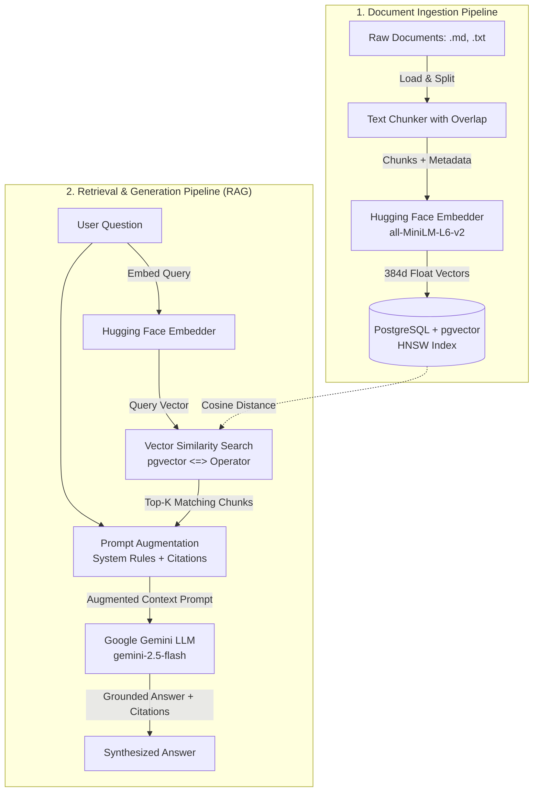

# 🧠 RAG Practice: Mastering Retrieval-Augmented Generation

A modular, production-inspired hands-on project to practice and master **Retrieval-Augmented Generation (RAG)** using:
- **Embedding Model**: Open-source Hugging Face embeddings (`sentence-transformers/all-MiniLM-L6-v2`) running locally for free.
- **Vector Database**: **PostgreSQL** with the **`pgvector`** extension running in Docker.
- **Generative LLM**: **Google Gemini API** (`gemini-2.5-flash` or `gemini-3.7-flash`) via the modern `google-genai` SDK.
- **Project & Package Management**: **`uv`** (fast Python package manager).

---

## 📐 Architecture & Workflow



---

## 🗂️ Project Structure

Every stage of the RAG process is separated into its own modular, independently runnable script with rich explanatory comments:

```
RAG_Practice/
├── docker-compose.yml          # PostgreSQL 16 + pgvector container definition
├── .env.example                # Template configuration file
├── .env                        # Your local settings & Gemini API key (git-ignored)
├── pyproject.toml              # UV / Python dependencies
├── main.py                     # Interactive CLI hub / command menu
├── sample_data/                # Rich test documents for knowledge base
│   ├── mars_rover_chronicles.txt
│   └── rag_guide.md
└── src/
    ├── __init__.py
    ├── config.py               # Central settings, environment variables & validation
    ├── db.py                   # PostgreSQL connection & pgvector table initialization
    ├── chunker.py              # Document loader & sliding-window text chunker
    ├── embedder.py             # Hugging Face sentence-transformers embedder
    ├── ingest.py               # Pipeline: load -> chunk -> embed -> store in pgvector
    ├── retriever.py            # Cosine similarity search using pgvector `<=>`
    └── rag_pipeline.py         # Full RAG: retrieve chunks -> build prompt -> Gemini answer
```

---

## 🚀 Quickstart Guide

### 1. Prerequisites
- [Docker Desktop](https://www.docker.com/) installed and running.
- [uv](https://docs.astral.sh/uv/) installed (or standard Python 3.11+).
- Free **Google Gemini API Key** from [Google AI Studio](https://aistudio.google.com/app/apikey).

### 2. Configure Environment Variables
Copy the template file `.env.example` to `.env`:
```powershell
cp .env.example .env
```
Open `.env` and set your `GEMINI_API_KEY`:
```env
GEMINI_API_KEY=AIzaSy...your_actual_key_here
```

### 3. Start PostgreSQL with pgvector in Docker
Run the Docker container in the background:
```powershell
docker compose up -d
```
Verify the container is healthy:
```powershell
docker compose ps
```

---

## 🧪 Step-by-Step Learning & Execution

Each script can be executed independently so you can inspect and understand every individual component of the pipeline.

### Step 1: Initialize Database & Vector Table (`src/db.py`)
Creates the `documents` table and enables the `vector` extension with an HNSW cosine index:
```powershell
uv run python src/db.py
```
> **Tip:** Pass `--reset` to drop the table and start fresh: `uv run python src/db.py --reset`.

---

### Step 2: Understand Document Chunking (`src/chunker.py`)
Examine how documents are split into overlapping segments so semantic context isn't severed across boundaries:
```powershell
uv run python src/chunker.py
```

---

### Step 3: Test Hugging Face Embeddings (`src/embedder.py`)
Computes 384-dimensional dense vectors using `all-MiniLM-L6-v2` and compares semantic similarity between related vs. unrelated sentences:
```powershell
uv run python src/embedder.py
```

---

### Step 4: Ingest Documents into PostgreSQL (`src/ingest.py`)
Loads documents from `sample_data/`, chunks them, generates vector embeddings, and stores them in PostgreSQL:
```powershell
uv run python src/ingest.py sample_data/
```
You can also ingest any custom file:
```powershell
uv run python src/ingest.py path/to/your_document.txt
```

---

### Step 5: Test Semantic Retrieval (`src/retriever.py`)
Executes vector similarity search against pgvector without invoking the LLM yet. See the raw cosine scores and matching text chunks:
```powershell
uv run python src/retriever.py "What were the rover's discoveries on Mars?" --top-k 3
```

---

### Step 6: Run Full RAG with Google Gemini (`src/rag_pipeline.py`)

#### Single Query Mode:
```powershell
uv run python src/rag_pipeline.py "What is the power source and scanning depth of the Zephyr-IV rover?"
```

#### Interactive Q&A Chat Session:
```powershell
uv run python src/rag_pipeline.py -i
```
Ask any questions about the sample documents (e.g., Martian exploration or RAG architecture), and Gemini will answer grounded strictly in the retrieved knowledge base!

---

### 🌟 Bonus: All-In-One Command Center (`main.py`)
Launch the interactive terminal menu to run any step with a single keypress:
```powershell
uv run python main.py
```

---

## 💡 Core RAG Concepts Explained

### 1. Why use pgvector in PostgreSQL?
Instead of adding a specialized vector database (Pinecone, Chroma, Qdrant, Milvus), `pgvector` allows you to store:
- Relational data (users, permissions, timestamps, foreign keys)
- Metadata (JSONB)
- Vector embeddings (`vector(384)`)
...all in **one ACID-compliant database**.

### 2. Distance Operators in pgvector
| Operator | Distance Metric | Description |
|---|---|---|
| `<=>` | **Cosine Distance** | `1 - Cosine Similarity`. Best for text embeddings where direction matters more than vector length. |
| `<->` | **Euclidean / L2** | Straight-line distance between points in multi-dimensional space. |
| `<#>` | **Negative Inner Product** | Multiplies dimensions directly. (When vectors are unit-normalized, Inner Product equals Cosine Similarity). |

### 3. What is an HNSW Index?
**Hierarchical Navigable Small World (HNSW)** is an index structure that builds a multi-layered graph of vectors. It enables **Approximate Nearest Neighbor (ANN)** search in $O(\log N)$ time, providing high recall and sub-millisecond query latency even across millions of rows.

### 4. Overcoming LLM Hallucinations
By combining:
- A strict system prompt (`"Answer ONLY using the provided context..."`),
- Low temperature (`0.2`), and
- Relevant context chunks with source filenames and chunk IDs,

the LLM becomes a grounded reasoning engine with verifiable citations.
